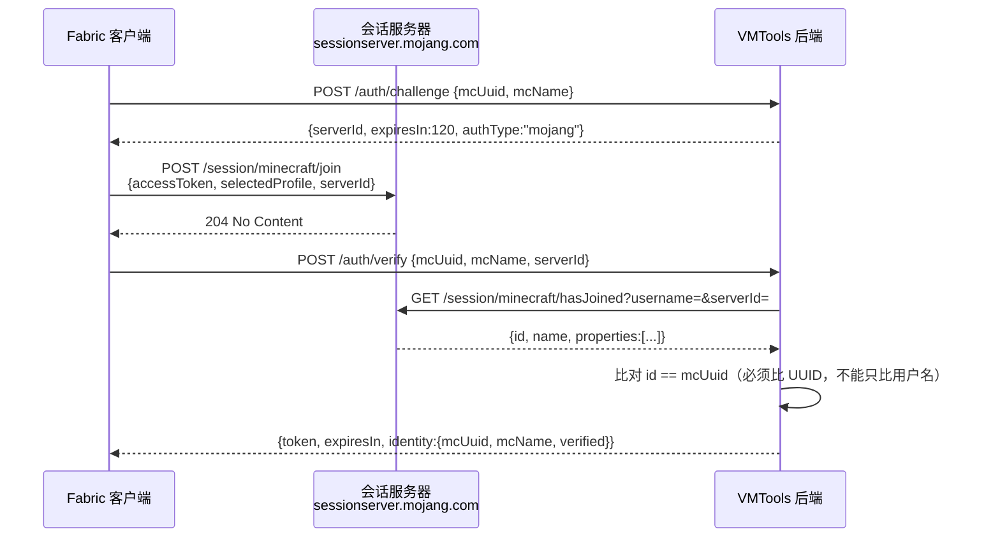
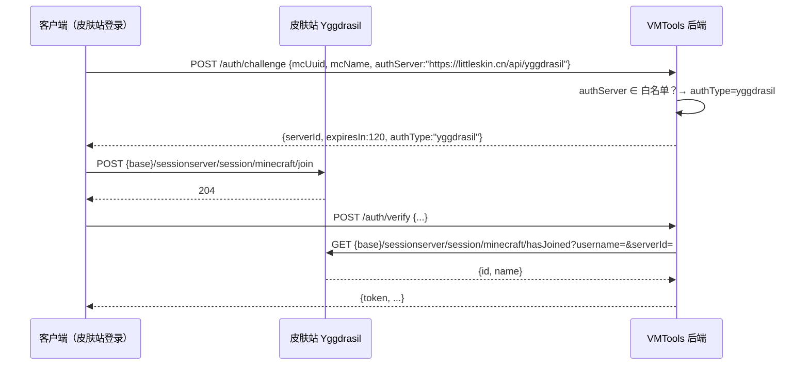
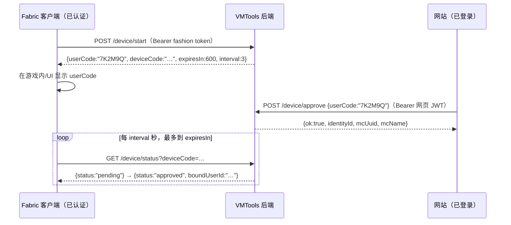

# 时装系统 API（VMFashion / MC 26.3 Fabric 客户端 mod）

> 面向 **mod 开发者**。后端实现见 `backend/src/vmtools_next/{core/fashion_auth.py,core/fashion_service.py,api/routers/fashion.py}`，
> 数据表见 `backend/src/vmtools_next/data/models/fashion.py` + `backend/alembic/versions/20261028_fashion.py`。

## 0. TL;DR —— mod 端只需三件事

1. **认证**：`POST /api/fashion/auth/challenge` → 客户端调会话服务器 `join` → `POST /api/fashion/auth/verify` 拿 `token`
2. **上报/拉取穿戴**：`PUT /api/fashion/loadout`、`GET /api/fashion/loadout/me`
3. **进服批量拉配置**：`POST /api/fashion/loadouts/resolve`（一次 ≤200 个 UUID，只返回 `assetKey`，资产再单独下）
4. **整包下发**：`GET /api/fashion/packs` 清单 → `GET /api/fashion/packs/{id}/{version}/download` 整包 zip
   （**"别人穿的时装我也能看见"的关键链路**，见 §6）

除公开接口（`POST /auth/challenge`、`POST /auth/verify`、`GET /packs`、`GET /packs/*/download`、
`GET /assets/*`）外，所有 mod/网站接口都要带 `Authorization: Bearer <token>`
（`/assets/*` 见 §8，时装包见 §6）。

- Base URL：`https://<你的 VMTools 站点>/api/fashion`
- 内容类型：`application/json`（资产上传为 `multipart/form-data`）
- 字段命名：**camelCase**
- 时间：ISO-8601 字符串（UTC）

---

## 1. 认证流程

目标 MC 服务器**同时开正版与皮肤站登录，没有离线玩家**，因此只有两条路径，
且都必须走「客户端先 join、后端再 hasJoined 反查」的标准三段式。

### 1.1 正版（Mojang / MSA）



### 1.2 皮肤站（authlib-injector / Yggdrasil 兼容）

协议完全一样，只把会话服务器换成皮肤站：

| 用途 | 正版 | 皮肤站 |
|---|---|---|
| join | `POST https://sessionserver.mojang.com/session/minecraft/join` | `POST {authServer}/sessionserver/session/minecraft/join` |
| hasJoined（后端调） | `GET .../session/minecraft/hasJoined` | `GET {authServer}/sessionserver/session/minecraft/hasJoined` |

`authServer` 由客户端上报（如 littleskin 为 `https://littleskin.cn/api/yggdrasil`）。
**后端只在配置白名单内使用它**：

- 在 `VMT_FASHION__YGGDRASIL_BASES` 里 → 优先用这个 base 反查
- 不在白名单（或格式非法）→ **直接忽略**，改用配置里的 bases；绝不会请求客户端给的任意地址（防 SSRF）
- 因此：**上线新皮肤站必须先让运维加进白名单**，否则该站玩家会收到 `not_joined`



### 1.3 serverId 的安全属性

| 属性 | 实现 |
|---|---|
| 一次性 | `verify` 消费即从内存表删除；重复使用返回 `challenge_not_found` |
| TTL | 默认 120s（`VMT_FASHION__CHALLENGE_TTL_SECONDS`），过期返回 `challenge_expired` |
| 绑定来源 | challenge 记录请求 IP，`verify` 的 IP 不一致 → `source_mismatch` |
| 绑定账号 | `verify` 的 `mcUuid`/`mcName` 必须与 challenge 一致，否则 `challenge_mismatch` |
| 限流 | 同一 IP 每 60s 最多 20 次 challenge，超出 429 `rate_limited` |

### 1.4 token

- JWT，HS256，`aud="fashion"`，`sub=<identity id>`，`exp` 默认 24h（`VMT_FASHION__TOKEN_TTL_SECONDS`）
- 用法：`Authorization: Bearer <token>`
- 失效：过期或签名不符 → HTTP 401 `{"detail":{"code":"invalid_token"}}`；此时重新走一遍 challenge/verify
- 与网页登录 JWT 是**两套**：网页 JWT 的 `sub` 是用户 id，时装接口同样接受（用于网站衣柜页），但 mod 请只用 fashion token

---

## 2. `POST /auth/challenge`

请求：

```json
{ "mcUuid": "12345678-1234-5678-1234-567812345678", "mcName": "Steve", "authServer": "" }
```

| 字段 | 必填 | 说明 |
|---|---|---|
| `mcUuid` | ✅ | 带不带连字符都行，大小写不限；后端统一存小写带连字符 |
| `mcName` | ✅ | 3-16 位 `[A-Za-z0-9_]` |
| `authServer` | ❌ | 皮肤站 base；正版玩家留空/不传 |

响应 `200`：

```json
{ "serverId": "9f2c...（32 位 hex）", "expiresIn": 120, "authType": "mojang" }
```

`authType` 是后端根据白名单判定的结果（`mojang` | `yggdrasil`），可用于 UI 提示。

## 3. `POST /auth/verify`

请求：

```json
{ "mcUuid": "…", "mcName": "Steve", "authServer": "", "serverId": "9f2c…" }
```

> `verify` 请求里的 `authServer` 仅作兼容保留：后端使用 `challenge` 阶段记录的地址，
> 防止在 verify 时被替换成攻击者地址。

响应 `200`：

```json
{
  "token": "eyJhbGciOiJIUzI1NiIs…",
  "expiresIn": 86400,
  "authType": "mojang",
  "identity": { "mcUuid": "12345678-1234-5678-1234-567812345678", "mcName": "Steve", "verified": true }
}
```

> ⚠️ **顺序要求**：必须先调会话服务器 `join` 成功，再调 `verify`。反过来会拿到
> `not_joined`（403）。`join` 与 `verify` 之间不要超过 `expiresIn`。

---

## 4. `GET /catalog`

查询参数（可选）：`category`（`cape|wings|hat|back|pet|aura|other`）、`pack_id`。

响应 `200`：

```json
{
  "items": [
    {
      "cosmeticId": "pack1:cape_dragon",
      "name": "龙翼披风",
      "category": "cape",
      "assetKey": "cape/dragon.png",
      "sha256": "3f2a…（64 位）",
      "bytes": 20480,
      "packId": "pack1",
      "sortOrder": 1
    }
  ]
}
```

- 只返回 `enabled=true` 的条目，按 `sortOrder` 升序
- `sha256` 可用于本地缓存判重：**同 sha256 不必重复下载**
- 目录缓存 30s（`VMT_FASHION__CATALOG_CACHE_TTL_SECONDS`），mod 端建议自己缓存 ≥60s

### 4.1 `cosmeticId` 契约（v1.0.1 起后端强制校验）

客户端的自动下发**只认冒号前缀**：`sync/AssetSyncService.requestMissing` 里
`cosmeticId.indexOf(':')` 找不到冒号就直接 `return`（既不下载包、也解析不出 packId）。
所以「目录里的 ID 形态」直接决定**别人穿这件时装时我能不能看见**：

| 形态 | 例子 | 后端行为 |
|---|---|---|
| **全局 ID**（推荐，也是新写入的规范形态） | `example:backboard` | 冒号前缀必须等于 `packId` 字段，`localId` 字符集 `[A-Za-z0-9._-]{1,96}`；否则 `invalid_cosmetic_id` 400 |
| 简单 ID（**legacy**，仅为兼容历史目录数据而保留） | `backboard` + `packId: "example"` | 仍可读写（否则旧数据无法维护），但客户端拿不到冒号前缀 → **不会整包下发**；建议尽快迁移成全局 ID |

- 全局 ID **只能有一个冒号**：`pack1:a:b`、`:cape`、`pack1:` 一律 `invalid_cosmetic_id`；
  前缀还必须能当客户端目录名（不能是 `server`、不能点开头，见 §6.3 的 packId 规则）。
- 管理端只给 `cosmeticId`（全局形式）时，`packId` 会**按前缀推导**；
  两边都写且不一致 → `invalid_cosmetic_id`。
- `GET /catalog` 返回的是**目录里存的原始形态**；`PUT /loadout` 落库时会规范成全局 ID（§5.1）。

---

## 5. 穿戴配置

### 5.1 `PUT /loadout`

**全量覆盖**：请求里没出现的槽位 = 卸下。

```json
{
  "items": [
    { "slot": "cape",  "cosmeticId": "pack1:cape_dragon", "scale": 1.0 },
    { "slot": "wings", "cosmeticId": "pack1:wings_angel", "scale": 0.75 }
  ]
}
```

| 约束 | 值 |
|---|---|
| `slot` | `cape|wings|hat|back|pet|aura|other`，同一请求内不可重复 |
| `cosmeticId` | 全局 ID `<packId>:<localId>`（§4.1）；目录里查不到 / 已下架 → **只跳过该条**（见下方部分成功语义） |
| `scale` | 0.25 – 4.0，越界自动夹紧；**省略（或传 `null`）= 沿用该槽位已保存的缩放值**，不是重置成 1.0 |
| 条数 | ≤ 8（`VMT_FASHION__MAX_LOADOUT_ITEMS`） |

**`scale` 省略语义（mod 正确性关键）**：mod 的 `HttpLoadoutProvider` **不上报 `scale`**
（缩放只由网页衣柜调），所以后端必须把「没传 scale」理解成「保持原值」：

- 首次穿戴（该槽位没有旧行）→ 用 `1.0`；
- 已存在该槽位 → 沿用旧 `scale`（例如网页里调成 2.5，mod 换装后仍是 2.5）；
- 显式传 `scale` → 按新值覆盖（越界夹紧到 `[0.25, 4.0]`）；
- 显式传 `null` 与省略等价（pydantic 的 `Optional[float]`，两者都落到「沿用」分支）。

**`cosmeticId` 落库规则**（A2 修复，2026-10-30 起）：

- 目录条目是全局 ID → 原样落库；
- 目录仍是 legacy 简单 ID、但玩家上报了全局 ID → **保留上报的全局 ID**（绝不降级成简单 ID）；
- 两边都是简单 ID → 保持简单 ID（旧数据/旧客户端向后兼容）。

> 为什么不能降级：客户端只认冒号前缀决定整包下发（§4.1）。旧实现把
> `example:backboard` 改写成目录里的 `backboard` 落库，结果这件时装**永远不会被
> 自动下发**，其他玩家也渲染不出来。

**部分成功语义**（2026-10-29 起）：

- 目录里**查不到**或**已下架**的 `cosmeticId` 只跳过该条，其余照常写入，响应 `200`；
  被跳过的条目放在 `warnings` 里（老客户端忽略未知字段即可）。
- 原因：mod 首次启动会释放内置示例包（`example:crown` 等本地包），这些 ID 云端目录里
  没有；若整条请求 404，玩家连本地其它合法时装都同步不了。
- 只有**请求体本身非法**才整条 4xx：`slot` 非法 / `slot` 重复 / 超过 8 条 /
  `scale` 非数字 / `cosmeticId` 为空。
- 注意：这是**全量覆盖**语义 —— 被跳过的槽位等于"没穿"，该槽位云端旧值会被清掉。

响应 `200`：

```json
{
  "ok": true,
  "updatedAt": "2026-10-28T15:00:00+00:00",
  "warnings": [
    { "slot": "cape", "cosmeticId": "example:crown", "code": "unknown_cosmetic" }
  ]
}
```

`warnings[].code`：`unknown_cosmetic`（目录里没有）| `cosmetic_disabled`（已下架）。

### 5.2 `GET /loadout/me`

```json
{
  "items": [
    {
      "slot": "cape", "cosmeticId": "cape_dragon", "scale": 1.0,
      "assetKey": "cape/dragon.png", "sha256": "3f2a…", "bytes": 20480,
      "name": "龙翼披风", "category": "cape", "missing": false,
      "packId": "wings", "packVersion": "1.2.0"
    }
  ]
}
```

- `missing=true` 表示目录条目已下架/删除（mod 应跳过渲染）。
- `packId` / `packVersion`（见 §6）：这件时装属于哪个包、当前包版本；目录条目没配
  `packId`、或该包还没发布 zip 时为空串（mod 会退化为从 `cosmeticId` 前缀推导 packId）。

### 5.3 `POST /loadouts/resolve`（热路径）

玩家进服时批量拉取。**只返回 assetKey 级别的元数据，绝不内联资产字节。**

```json
{ "mcUuids": ["12345678-1234-5678-1234-567812345678", "aaaaaaaa-bbbb-cccc-dddd-eeeeeeeeeeee"] }
```

响应 `200`：

```json
{
  "loadouts": {
    "12345678-1234-5678-1234-567812345678": {
      "items": [
        { "slot": "cape", "cosmeticId": "cape_dragon", "assetKey": "cape/dragon.png",
          "sha256": "3f2a…", "bytes": 20480, "scale": 1.0,
          "packId": "wings", "packVersion": "1.2.0" }
      ]
    }
  },
  "missing": ["aaaaaaaa-bbbb-cccc-dddd-eeeeeeeeeeee"]
}
```

| 规则 | 说明 |
|---|---|
| 上限 | 单次 **200** 个 UUID（`VMT_FASHION__RESOLVE_MAX_UUIDS`），超出 400 `too_many_uuids` |
| `missing` | 未认证过的 UUID + 格式非法的 UUID（原样回显） |
| 已认证但没穿 | 出现在 `loadouts` 里，`items: []`（**不是** missing） |
| 缓存 | 后端 5s 进程内缓存；mod 端建议进服时一次批量、结果缓存到玩家下线 |
| 性能 | 后端一次 SQL 批量取身份 + 一次批量取穿戴，不是 N+1 |

---

### 5.4 我的衣柜（收藏制）——`/wardrobe`（网站专用）

> **只服务网站**，mod 不调用（mod 没有「收藏」概念，它只读 `/loadout/me`）。
> 鉴权一律 **网页登录 JWT**（`api/deps.py:get_current_user`），维度是**网站账号**：
> 一个账号绑定的多个 MC 身份共享同一份衣柜；穿戴配置（§5）才是身份维度。

「衣柜」是**玩家主动收藏的时装**，不是站点目录的子集查询：商店页点「加入衣柜」才进衣柜，
衣柜页左侧只渲染这份收藏（历史行为是直接渲染全站目录，玩家反馈「衣柜里全是时装」后改的）。

| 方法 | 路径 | 说明 |
|---|---|---|
| GET | `/api/fashion/wardrobe` | 我的衣柜，按 `addedAt` **倒序** |
| POST | `/api/fashion/wardrobe` | `{cosmeticId}` 加入衣柜，**幂等** |
| DELETE | `/api/fashion/wardrobe/{cosmeticId}` | 单件移除，**幂等**（含冒号的 id 前端要 `encodeURIComponent`） |
| POST | `/api/fashion/wardrobe/batch-delete` | `{cosmeticIds:[…]}` 批量移除（衣柜页「全选删除」） |

`GET` 响应 `200`：

```json
{ "items": [
  { "cosmeticId": "lw_angel:angel", "name": "Angel Wings", "category": "wings",
    "packId": "lw_angel", "assetKey": "lw_angel/1.0.0/xxx.webp", "sha256": "…", "bytes": 5670,
    "sortOrder": 0, "addedAt": "2026-11-01T03:04:15.346360+00:00", "missing": false }
] }
```

| 规则 | 说明 |
|---|---|
| `missing` | 目录里已删除或已停用（`enabled=false`）→ **条目仍返回**（玩家才删得掉），此时不可穿戴；目录行还在时 `name` 等字段用残留值，目录行已删则给空串 |
| `added` | `POST` 的 `added=false` 表示本来就在衣柜里（幂等，仍是 `200`），前端不必当失败 |
| `removed` | `DELETE` / 批量删除的 `removed` 是**真正删掉**的数量；不存在的 id 静默忽略（幂等） |
| 目录校验 | 加入衣柜时 cosmeticId 必须在目录里且 `enabled=true`，否则 `404 cosmetic_not_found`；空/超长 → `400 invalid_cosmetic_id` |
| 批量上限 | 去重后 **500** 条（`MAX_WARDROBE_BATCH_DELETE`），超出 `400 too_many_items`；空数组 `400 empty_selection` |
| 外键 | `fashion_wardrobe.user_id → users.id`；`cosmetic_id` **故意不做外键**（删目录不该清空玩家衣柜） |
| 唯一约束 | `(user_id, cosmetic_id)`，并发重复加入靠它兜底（回滚重查后仍返回 `added=false`，不抛 409） |

---

### 5.5 `GET /wardrobe/me` —— mod 端拉收藏

mod 的游戏内衣柜按这份清单过滤（只有网站衣柜里收藏的时装才显示）。鉴权用 **`get_principal`**：
mod 的 fashion token 与网页 JWT 都接受，按 `principal.user_id` 反查网站账号。

```http
GET /api/fashion/wardrobe/me HTTP/1.1
Authorization: Bearer <fashion token 或 网页 JWT>
```

响应 `200`（**精简条目**，只有 mod 需要的 5 个字段）：

```json
{ "linked": true,
  "items": [ { "cosmeticId": "lw_angel:angel", "name": "Angel Wings",
               "category": "wings", "packId": "lw_angel", "missing": false } ] }
```

| 字段 | 说明 |
|---|---|
| `linked` | 该 MC 身份是否已绑定网站账号。**`false` 时 `items` 必为空**，客户端必须理解成「没有衣柜可参照」→ 退回显示本地已装全部，而不是"衣柜是空的" |
| `items[].cosmeticId` | 全局 ID `<packId>:<localId>` |
| `items[].name` / `category` / `packId` | 供"本地没装包"时也能在界面列出这件时装 |
| `items[].missing` | 目录里已删除/已停用：mod 显示但禁止穿戴 |

客户端行为（`VMFashion-mod` 的 `WardrobeCollection` + `SyncService#refreshWardrobe`）：

- 进服认证成功后拉一次；此后每 **5 分钟**最多一次；绑定成功后再拉一次（`linked` 会变）；
- 401 → 走 mod 既有的重新认证流程，**只重试一次**（防认证风暴）；
- 404/405/501（自建后端没实现这个端点）→ 记一次日志后本会话不再重试；
- 其它失败 → 指数退避（30s 起，封顶 5min），**绝不清空**已有收藏；
- 拉到后落盘 `config/vmfashion/wardrobe.json`（原子写），断网/后端挂了时用缓存过滤。

---

## 6. 包级下发（时装包 zip）

> 为什么需要这一层：`resolve` / `loadout/me` 是**按单件资源**设计的（`assetKey` 是单个文件），
> 而一件时装的运行时单位是**目录**（`model.geo.json` + `texture.png` + 可选 `emissive.png` / `anim.json`）。
> 所以还需要"清单 → 整包 zip → 客户端安全解压安装"这条链路。
> 客户端实现：`net/PackCatalog.java`、`net/PackDownloader.java`、`net/SafeZip.java`、`sync/AssetSyncService.java`。

### 6.1 `GET /packs` —— 包清单（公开）

```http
GET /api/fashion/packs
Accept: application/json
Authorization: Bearer <token>   # 可选：公开接口，带不带都行
```

**必须 200 直出 JSON**（客户端 `HttpClient.Redirect.NEVER`，不跟随 302）。
客户端本地缓存 10 分钟，服务端给 `Cache-Control: public, max-age=300`。

响应 `200`：

```json
{
  "packs": [
    {
      "id": "wings",
      "version": "1.2.0",
      "sha256": "9f2c1a4b7d8e0f3a5b6c7d8e9f0a1b2c3d4e5f60718293a4b5c6d7e8f9012345",
      "bytes": 481203,
      "url": "/packs/wings/1.2.0/download",
      "publishedAt": 1735603200000,
      "signature": "…（可选，见 6.4）",
      "signingKeyId": "vmtools-official"
    }
  ]
}
```

| 字段 | 类型 | 说明 |
|---|---|---|
| `id` | string | packId。**同时是客户端目录名**，`[A-Za-z0-9._-]{1,64}`，不能是 `.` / `..` / `server` / 点开头 |
| `version` | string | 包版本，`[A-Za-z0-9._-]{1,64}` |
| `sha256` | string | 整包 zip 的 sha256（64 位小写 hex），客户端下载后校验 |
| `bytes` | number | zip 精确字节数（> 0），客户端边下边校验 |
| `url` | string | 相对 `apiBaseUrl`（`…/api/fashion`）的下载地址，**不要**写 `/api/fashion/packs/...` |
| `publishedAt` | number | 发布时间，**毫秒时间戳** |
| `signature` / `signingKeyId` | string | 可选，未配置签名私钥时**不输出这两个字段**（见 6.4） |

> ⚠️ **时间字段的唯一例外**：本文档其它地方的时间都是 ISO-8601 字符串，只有
> `publishedAt` 必须是**毫秒 number**（客户端 `PackCatalog` 用 `getAsLong()` 读，
> 给字符串会静默变成 0）。**不要"统一风格"改回 ISO-8601。**

空清单返回 `200` + `{"packs": []}`（不是 404）。客户端不会用空清单覆盖本地磁盘缓存。

错误语义（客户端据此降级）：

| HTTP | 客户端行为 |
|---|---|
| 404 / 405 / 501 | 判定"后端未实现"，**本次会话关闭自动下发**（只记一次日志） |
| 5xx | 30s 后重试 |
| 401 | 走同步层重新认证（清单本身建议公开，不必 401） |

### 6.2 `GET /packs/{id}/{version}/download` —— 整包 zip（公开）

```http
GET /api/fashion/packs/wings/1.2.0/download
Accept: application/zip, application/octet-stream
```

硬性要求（客户端会按这些假设校验，任何一条不满足都会判定下载失败）：

1. **200 直出字节流，不能 302 到 CDN**（客户端不跟随重定向）。要放 CDN 请在清单里给绝对 `url`。
2. **`Content-Length` 必须准确**且等于清单里的 `bytes`（`FileResponse` 按 `os.stat` 自动填）。
3. **`Content-Type: application/zip`**。
4. 不要求 / 不支持 Range（客户端每次整包下载）；支持 `HEAD`（联调自测用 `curl -sI`）。
5. `ETag` 可选（这里给 `"<sha256>"`）。

错误：包不存在 / 已下架 / 磁盘文件丢失 → `404 {"detail":{"code":"pack_not_found","message":"…"}}`。
**不要返回 5xx**：客户端对 404 只是"该包冷却 10 分钟"，对 5xx 会持续退避重试。

### 6.3 zip 结构与上传校验

zip **根目录直接是包内容**（不要多套一层文件夹）：

```
wings.zip
├── pack.json            # 必需，且 "id" 必须与清单 id 一致（大小写不敏感）
└── cosmetics/crown/
    ├── model.geo.json
    └── texture.png
```

上传（§10 `POST /admin/packs`）时服务端就按客户端同一套规则静态校验，坏包直接拒绝，
玩家端只会看到"没有这个包"，而不是安装失败：

| 规则 | 值 |
|---|---|
| 条目数 | ≤ 4096 |
| 单文件解压后 | ≤ 64 MB |
| 总解压大小 | ≤ 512 MB |
| zip 本身 | ≤ 64 MB（`MAX_ASSET_BYTES`；客户端硬上限 128 MB） |
| 压缩比 | ≤ 100:1（仅当解压后 > 10 MB） |
| 条目名长度 | ≤ 255 |

一律拒绝：`..` 逃逸、绝对路径、Windows 盘符（`C:`）、UNC、NTFS 数据流（`a:b`）、Windows 保留
设备名（`CON`/`NUL`/`COM1`…）、符号链接等非普通文件、加密 zip、ZIP64、非 stored/deflate
压缩算法、仅大小写不同的重复条目、文件与目录同名、可执行文件（`.exe`/`.jar`/`.sh`/`.dll`…）、
隐藏文件（`.` 开头）、`pack.json` 缺失 / 超过 1 MB / `id` 与 packId 不一致。

> 因此：**`.zip` 一律按时装包处理**（即使走 §10 的 `POST /admin/assets`）。
> 单件资产请用 png / glb / json 等格式。

### 6.4 签名（Ed25519，可选）

`sha256` 只能防传输损坏，防不了恶意源。清单条目可以带 Ed25519 签名，客户端在**解压前**验签。

签名覆盖的规范化字节串（逐字节，不得改动）：

```
UTF-8( trim(packId) + "\n" + trim(version) + "\n" + lowercase(sha256hex) )
```

- 三段用**单个** `\n` 连接，**结尾没有换行**；
- `signature` 是 64 字节签名的**标准 base64**（不是 URL-safe，不带 `ed25519:` 前缀）；
- `signingKeyId` 对应客户端 `config/vmfashion/trusted_keys.json` 里的 `keys[].id`；
- `url` / `publishedAt` 不参与签名（换 CDN 不用重签）。

后端行为：

- 配置了 `VMT_FASHION__PACK_SIGNING_KEY_B64`（且装了 `cryptography`）→ 清单自动带
  `signature` / `signingKeyId`；**两条部署路径（`deploy/Dockerfile`、`deploy/install.sh`）
  现在都会安装 `[signing]` extra**，所以配了私钥就能真正签上（此前 Dockerfile 只装
  `[dev]`、install.sh 只装 `.`，配了私钥也只会 warn 降级）；
- **没配置**（默认）→ 不输出这两个字段。此时客户端宽松模式放行并记一次 warn，
  但**严格模式（`requireSignature: true`）会拒绝全部服务端包** ——
  **未配置私钥时不要在客户端开严格模式**（fail-closed）。
- 私钥只存在服务端（环境变量 / KMS），**绝不能**进客户端仓库或 git。

### 6.5 下架

`DELETE /api/fashion/admin/packs/{packId}/{version}`（§10）把包从 `/packs` 移除。
已下载到玩家本地的包**不会被远程删除**（远程删文件的能力本身就是风险），
需要清理请让玩家执行 `/vmfashion cache clear`。

## 7. 设备码：把 MC 身份绑到网站账号

网页拿不到 MC 的 accessToken，所以**网页绑定走设备码**：mod 显示 6 位码，用户在网页输入。



| 接口 | 调用方 | 说明 |
|---|---|---|
| `POST /device/start` | mod | 需 fashion token；返回 6 位 `userCode`（去掉 I/O/0/1 的字母表）与 `deviceCode` |
| `POST /device/approve` | 网页 | 需网页登录 JWT；`{userCode}` 或 `{deviceCode}`；绑定码已被他人使用 → 409 `device_bound_to_other`；该 MC 身份已绑到其他网站账号 → 409 `identity_bound_to_other` |
| `GET /device/status?deviceCode=` | mod | `status`: `pending` / `approved` / `expired`；只能查自己的 deviceCode |

绑定后 `fashion_identity.user_id` 指向网站账号，网页衣柜即可操作同一份穿戴配置。
一个网站账号可绑定多个 MC 身份；网页接口可用 `?identityId=` 指定操作哪一个。

> `deviceCode` 只能走 query（mod 端 `FashionApi.java` 固定拼 `GET /device/status?deviceCode=…`，
> 改成 body 会破坏客户端契约）。因此它可能进入反代 access log（combined 格式记录 `$request`），
> 生产请对 access log 脱敏或限权；后端自身的日志只打印脱敏后的 `userCode`（前 2 位 + `***`）。

---

## 8. `GET /assets/{assetKey}`

- **公开可读**（不需要 token）：资产按 sha256 内容寻址、本身无隐私；`` 也无法带 Authorization 头
- 响应头：`Cache-Control: public, max-age=31536000, immutable`、`ETag`、`X-Content-Type-Options: nosniff`
- 解析顺序：`catalog.asset_key → catalog.sha256 → fashion_asset.storage_path`；若目录条目**没有 sha256**（手工静态资产起步流），再退回 `{assetDir}/{assetKey}`
- 回退分支的安全边界（2026-10-30 审计修复）：只服务「目录里登记过」或「`fashion_asset` 表里登记过的 `storagePath`」（管理端资产列表预览用）且扩展名在白名单内的文件；asset root 下的其它文件（README、DB、误放文件）一律 404，已下架（`enabled=false`）条目的资产也不会再被该分支绕过
- 目录穿越防护：`..`、绝对路径、盘符、空字节一律 404
- 404 → `{"detail":{"code":"asset_not_found","message":"资产不存在"}}`

mod 端建议：先看本地 `sha256` 是否已有；没有才下载，下载后按 sha256 存本地缓存。

---

## 9. 错误码

**时装业务层**的错误统一是 HTTP 状态码 + 结构化 detail：

```json
{ "detail": { "code": "challenge_expired", "message": "serverId 已过期，请重新发起认证" } }
```

> 例外（不是时装业务层产生，客户端按 HTTP 状态兜底即可，**不要假设一定有 `code`**）：
> - 401/403 来自共享鉴权依赖（`api/deps.py`），detail 是字符串（如 `"Missing authentication token"`）；
> - 422 是 FastAPI 请求体校验，detail 是数组（`[{type, loc, msg, input}]`）；
> - 未命中路由的 404 是 `{"detail":"Not found"}`（含 `/api`、`/api/xxx` 等未注册路径，不会回落 index.html）；
> - `/api/xxx/` 带尾斜杠且存在同名精确路由时返回 307，否则 404。

| code | HTTP | 含义 / mod 处理 |
|---|---|---|
| `invalid_uuid` | 400 | UUID 格式非法（本地就该校验） |
| `invalid_mc_name` | 400 | 用户名非法 |
| `invalid_auth_server` | 400 | authServer 格式非法（https / 无 userinfo） |
| `challenge_not_found` | 400 | serverId 不存在或已用过 → 重新 challenge |
| `challenge_expired` | 400 | 超过 120s → 重新 challenge |
| `challenge_mismatch` | 403 | serverId 与 mcUuid/mcName 不符 |
| `source_mismatch` | 403 | verify 的来源 IP 与 challenge 不一致（代理链路要保证同 IP） |
| `uuid_mismatch` | 403 | 会话服务器返回的 UUID ≠ 声明的 UUID（**冒用/作弊信号**） |
| `not_joined` | 403 | 会话服务器没确认 join → 检查 join 是否成功、顺序是否颠倒 |
| `upstream_unavailable` | 503 | 会话服务器超时/不可用（5s 超时）→ 稍后重试 |
| `server_misconfigured` | 500 | 服务端未配置 JWT 签名密钥（`VMT_SERVER__SECRET_KEY` 缺失/过短/占位值）→ 运维问题，不是玩家问题 |
| `invalid_token` | 401 | token 过期/无效 → 重新认证 |
| `unauthorized` | 401 | 没带 Bearer |
| `no_identity` | 409 | 网页 JWT 尚未绑定 MC 身份 |
| `identity_not_found` | 404 | 身份不存在 |
| `forbidden` | 403 | 越权访问他人身份 |
| `too_many_uuids` | 400 | resolve 超过 200 |
| `invalid_slot` / `duplicate_slot` | 400 | 槽位非法/重复 |
| `invalid_cosmetic_id` | 400 | `cosmeticId` 不符合 `<packId>:<localId>`（空 / 多个冒号 / 前缀≠`packId` / 前缀不能当 packId 用 / localId 字符非法）。**管理端写入**严格校验（§4.1）；`PUT /loadout` 只有「`cosmeticId` 为空」才 4xx，其余查不到的一律按 `unknown_cosmetic` 跳过（见 §5.1） |
| `invalid_category` | 400 | `category` 不在 `cape` / `wings` / `hat` / `back` / `pet` / `aura` / `other` 内（管理端写入 / `GET /catalog` 过滤参数） |
| `invalid_request` | 400 | 请求体结构不对（如 `mcUuids` 不是数组） |
| `unknown_cosmetic` | — | **不再作为整条 4xx**：只在 `PUT /loadout` 的 `warnings[].code` 里出现 |
| `cosmetic_disabled` | — | 同上（`warnings[].code`），条目被跳过 |
| `pack_not_found` | 404 | 包不存在 / 已下架 / 文件丢失（客户端冷却 10 分钟） |
| `invalid_pack_id` | 400 | packId 不合规（客户端目录名规则） |
| `invalid_pack_version` | 400 | packVersion 不合规（`[A-Za-z0-9._-]{1,64}`） |
| `invalid_pack_zip` | 400 | zip 结构不安全 / 缺 pack.json / 含可执行文件等（见 §6.3） |
| `pack_id_mismatch` | 400 | pack.json 的 id 与 packId 不一致 |
| `pack_too_large` | — | **不会出现**：HTTP 上传在读流阶段就被 64MB 上限拦下并返回 `asset_too_large`（见下一行）；`pack_too_large` 只是 `validate_pack_zip` 内部的兜底分支（HTTP 不可达） |
| `pack_in_use` | 409 | 包的 sha256 仍被目录条目引用，不能下架 |
| `conflict` | 409 | 并发写冲突（同一身份同时保存 loadout / 同一 MC UUID 并发 verify / 管理端并发创建同一条目）；客户端整体重试即可，不要当成永久错误 |
| `pack_not_published` | 500 | 包已保存但未能生成清单项（异常兜底，正常不会出现） |
| `invalid_scale` | 400 | scale 非数字 |
| `too_many_items` | 400 | 超过 8 个槽位 |
| `device_not_found` | 404 | 绑定码不存在 |
| `device_expired` | 400 | 绑定码过期（10 分钟） |
| `device_bound_to_other` | 409 | 绑定码已被其他账号使用 |
| `identity_bound_to_other` | 409 | 该 MC 身份已绑定到其他网站账号 |
| `asset_not_found` | 404 | 资产不存在 |
| `asset_too_large` | 413 | 单个资产超过 64MB（`/admin/assets`、`/admin/packs` 都会在读流时提前 413） |
| `empty_asset` | 400 | 上传内容为空（0 字节） |
| `invalid_asset_key` | 400 | `assetKey` 非法（绝对路径 / 含 `..` 等穿越形态） |
| `invalid_filename` | 400 | 上传文件名非法（清洗后为空 / 含控制字符） |
| `unsupported_asset_type` | 400 | 扩展名不在白名单（png/jpg/jpeg/webp/gif/glb/gltf/bin/ogg/wav/json/zip/bbmodel） |
| `cosmetic_not_found` | 404 | 管理端引用的 `cosmeticId` 在目录里不存在（`POST /admin/assets` 的 `cosmetic_id`、`PUT /admin/catalog/{id}`） |
| `rate_limited` | 429 | challenge / device-approve / device-start 太频繁；响应带 `Retry-After: 60`（秒） |
| `empty_selection` | 400 | 我的衣柜批量删除时 `cosmeticIds` 去重后为空（§5.4） |
| `too_many_items` | 400 | 槽位超过 8 个（`PUT /loadout`）；**我的衣柜**批量删除去重后超过 500 条也用这个 code（§5.4） |

---

## 10. 管理端（site_admin）

| 方法 | 路径 | 说明 |
|---|---|---|
| GET | `/api/fashion/admin/catalog` | 全部条目（含 disabled） |
| POST | `/api/fashion/admin/catalog` | 新建：`{cosmeticId, name, category, assetKey, packId, sha256?, bytes?, enabled?, sortOrder?}` |
| PUT | `/api/fashion/admin/catalog/{cosmeticId}` | 更新（部分字段） |
| DELETE | `/api/fashion/admin/catalog/{cosmeticId}` | 删除 |
| GET | `/api/fashion/admin/assets?pack_id=` | 资产列表 |
| POST | `/api/fashion/admin/assets` | `multipart/form-data`：`file` + `pack_id` + `version` + `cosmetic_id`（带 cosmetic_id 时自动回填 sha256/bytes） |
| POST | `/api/fashion/admin/packs` | **发布时装包**：`multipart/form-data`：`file`（.zip）+ `pack_id` + `version`；返回 `{ok, pack:{…}}`（§6 的清单项） |
| DELETE | `/api/fashion/admin/packs/{packId}/{version}` | 下架时装包（`pack_in_use` → 409） |

资产限制：≤64MB，扩展名白名单（png/jpg/jpeg/webp/gif/glb/gltf/bin/ogg/wav/json/zip/bbmodel），
同 `sha256` + 文件名 + packId + version 自动去重（**同内容不同文件名会各存一份**，历史行为；
模型注释里的「同一 sha256 只落盘一份」是旧描述，以本节为准）。

> `.zip` 无论走 `/admin/assets` 还是 `/admin/packs`，都会按 §6.3 的时装包规则校验
> （根目录 `pack.json` 且 id 与 packId 一致）。**发布时装包请用 `/admin/packs`**：
> 它的 packId / version 是严格校验的（不做静默清洗），并且会直接返回清单项。

> **`cosmeticId` 命名（与 mod 对齐，后端已强制校验）**：mod 上报的穿戴 ID 是全局 ID
> `<packId>:<localId>`（例如 `example:backboard`）。catalog 的 `cosmeticId` 请直接使用
> 该全局 ID：**冒号前缀必须等于 `packId` 字段**，否则 `invalid_cosmetic_id` 400（§4.1）。
>
> 兼容性说明（2026-10-30 起）：
> - 历史**简单 ID** 目录条目仍可读写（不会让旧数据变成不可维护），但它们**不会触发**
>   客户端整包下发，建议用 `PUT /admin/catalog/{id}` 之外的方式迁移（删旧建新，并把
>   loadout 里引用的旧 ID 一并改写）；迁移期间 `PUT /loadout` 的 `localId` 回退匹配
>   仍然生效，保证「玩家上报全局 ID、目录还是简单 ID」的组合不会丢件。
> - 写入 loadout 时后端**不会**再把全局 ID 降级成简单 ID（§5.1），这是 v1.0.1 客户端
>   「别人穿的时装我能不能看见」的前提。**例外**：上报前缀与目录 `packId` 不一致（或目录
>   `packId` 为空）时，后端按目录 ID 纠正后保存并记一条 warn 日志——避免落库一个
>   `_catalog_map` 里解析不到的 ID（那会让 `loadout/me` 立即 `missing`、`resolve` 丢弃）。
> - 并发写冲突（同一身份同时保存、同一 MC UUID 并发 verify 等）返回 409 `conflict`，
>   客户端整体重试即可。

---

## 11. 服务端配置项

| 环境变量 | 默认值 | 说明 |
|---|---|---|
| `VMT_FASHION__ENABLED` | `true` | 总开关 |
| `VMT_FASHION__YGGDRASIL_BASES` | `https://littleskin.cn/api/yggdrasil` | 皮肤站白名单，逗号分隔，可多个 |
| `VMT_FASHION__MOJANG_SESSION_SERVER` | `https://sessionserver.mojang.com` | 正版会话服务器 |
| `VMT_FASHION__CHALLENGE_TTL_SECONDS` | `120` | serverId 有效期 |
| `VMT_FASHION__TOKEN_TTL_SECONDS` | `86400` | mod token 有效期 |
| `VMT_FASHION__HTTP_TIMEOUT_SECONDS` | `5.0` | 所有外呼超时 |
| `VMT_FASHION__ASSET_DIR` | `data/fashion-assets` | 资产目录（相对仓库根） |
| `VMT_FASHION__RESOLVE_MAX_UUIDS` | `200` | 单次 resolve 上限 |
| `VMT_FASHION__RESOLVE_CACHE_TTL_SECONDS` | `5` | resolve 缓存 |
| `VMT_FASHION__CATALOG_CACHE_TTL_SECONDS` | `30` | 目录缓存 |
| `VMT_FASHION__MAX_LOADOUT_ITEMS` | `8` | 槽位上限 |
| `VMT_FASHION__DEVICE_CODE_TTL_SECONDS` | `600` | 绑定码有效期 |
| `VMT_FASHION__DEVICE_POLL_INTERVAL_SECONDS` | `3` | mod 轮询绑定状态的建议间隔（秒） |
| `VMT_FASHION__PACK_SIGNING_KEY_B64` | 空 | 时装包 Ed25519 私钥（base64，裸 32 字节种子或 PKCS#8 DER）。空 = 清单不带签名 |
| `VMT_FASHION__PACK_SIGNING_KEY_ID` | `vmtools-official` | 签名 keyId（对应客户端 `trusted_keys.json`，密钥轮换用） |

> 多 worker 部署时，challenge/deviceCode 存在**单进程内存**里：请让 mod 的
> challenge→verify 打到同一实例（nginx `ip_hash` / 单 worker），或改用粘性会话。

---

## 12. 快速自测（curl）

```bash
BASE=https://your-host/api/fashion
UUID=12345678-1234-5678-1234-567812345678

# 1) challenge
curl -s -X POST $BASE/auth/challenge -H 'Content-Type: application/json' \
  -d "{\"mcUuid\":\"$UUID\",\"mcName\":\"Steve\"}"

# 2) 客户端 join 后 verify
curl -s -X POST $BASE/auth/verify -H 'Content-Type: application/json' \
  -d "{\"mcUuid\":\"$UUID\",\"mcName\":\"Steve\",\"serverId\":\"<上一步的 serverId>\"}"

# 3) 时装包清单 / 下载（契约 §6：200 直出、Content-Length == bytes、无 302）
curl -s "$BASE/packs" | jq '.packs[0]'
curl -sI "$BASE/packs/wings/1.2.0/download" | grep -iE 'HTTP/|content-length|content-type|location'
curl -s "$BASE/packs/wings/1.2.0/download" -o /tmp/wings.zip && sha256sum /tmp/wings.zip

# 4) 目录 / 穿戴 / 批量解析
TOKEN=<token>
curl -s $BASE/catalog -H "Authorization: Bearer $TOKEN"
curl -s -X PUT $BASE/loadout -H "Authorization: Bearer $TOKEN" -H 'Content-Type: application/json' \
  -d '{"items":[{"slot":"cape","cosmeticId":"cape_dragon","scale":1.0}]}'
curl -s -X POST $BASE/loadouts/resolve -H "Authorization: Bearer $TOKEN" -H 'Content-Type: application/json' \
  -d "{\"mcUuids\":[\"$UUID\"]}"
```

---

## 13. 部署注意

1. **反向代理要传真实 IP**：challenge 会绑定请求来源 IP，verify 时比对。若 uvicorn
   没开 `--proxy-headers --forwarded-allow-ips='*'`，`request.client.host` 恒为
   127.0.0.1 —— 握手仍能成功（两端一致），但「来源绑定」的防重放强度下降。
   ⚠️ **后端端口必须只对反代网段开放**：`forwarded_allow_ips="*"` 意味着任何能直连
   后端端口的人都能伪造 `X-Forwarded-For`，challenge 的来源 IP 绑定与限流就形同虚设。
   默认 `docker-compose.yml` 把 `8080:8080` 映射到宿主机（nginx 服务默认注释掉），
   等于满足「可直连」条件——生产请改成 `127.0.0.1:8080:8080` 并启用 nginx 反代，
   或至少用防火墙限制 8080 来源。后端启动时若监听地址不是回环会打印一条 warn 提示。
2. **多 worker**：challenge / deviceCode 存在进程内存，`--workers > 1` 时 mod 的
   challenge→verify 可能落到不同进程 → `challenge_not_found`。要么单 worker（默认），
   要么 nginx `ip_hash` 粘性会话。
3. **资产目录持久化**：默认 `data/fashion-assets`（相对仓库根）。Docker 部署请把
   该目录挂到持久卷，否则重建容器后资产丢失（目录条目还在，下载 404）。
4. **数据库**：`alembic upgrade head` 建表；`init_db()` 的 `create_all` 也会建
   （迁移是幂等的，重复执行安全）。
5. **新增皮肤站**：必须同时把 base 加进 `VMT_FASHION__YGGDRASIL_BASES`，否则该站
   玩家会收到 `not_joined`（客户端上报的地址不在白名单会被忽略）。
6. **限流是进程内的**：challenge / device-approve / device-start 的滑动窗口在单进程内存里，
   `--workers > 1` 时实际上限 = 单进程上限 × worker 数；要严格限流需在反代层做。
7. **时装包签名需要 `cryptography`**：`pyproject.toml` 里它是可选 extra `signing`。
   根 `Dockerfile` 与 `backend/deploy/Dockerfile` 都装 `.[dev,signing]`、
   `backend/deploy/install.sh` 装 `.[signing]`，所以按仓库脚本部署默认就带签名能力。
   **只有手工 `pip install -e .` 才需要自己补 `.[signing]`**。没装时后端记一条 warn
   并降级为不签名（`/packs` 不会 500），此时同样**不要**开客户端严格模式。升级后请用
   `curl -s /api/fashion/packs | grep signature` 确认签名真的生效。
8. **下架不等于远程删除**：`DELETE /admin/packs/{id}/{version}` 只从清单移除，
   玩家本地已下载的包不受影响（需要时让玩家 `/vmfashion cache clear`）。
